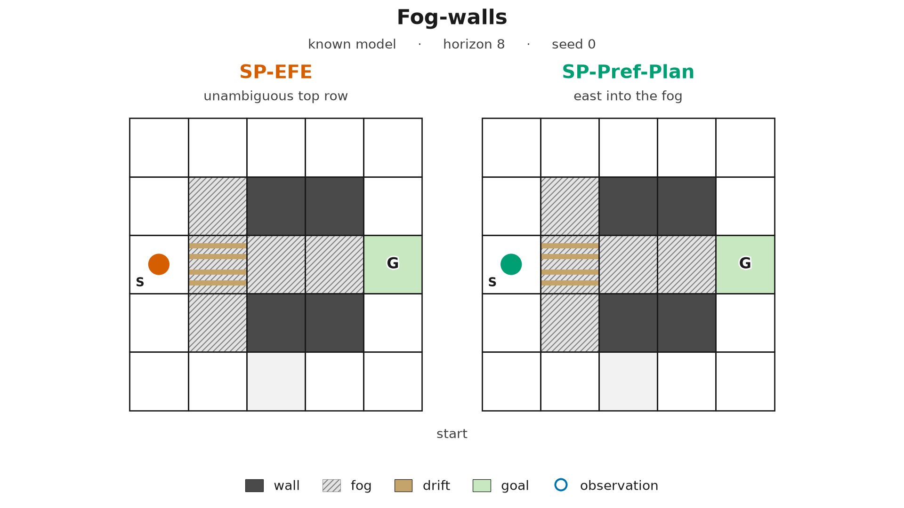
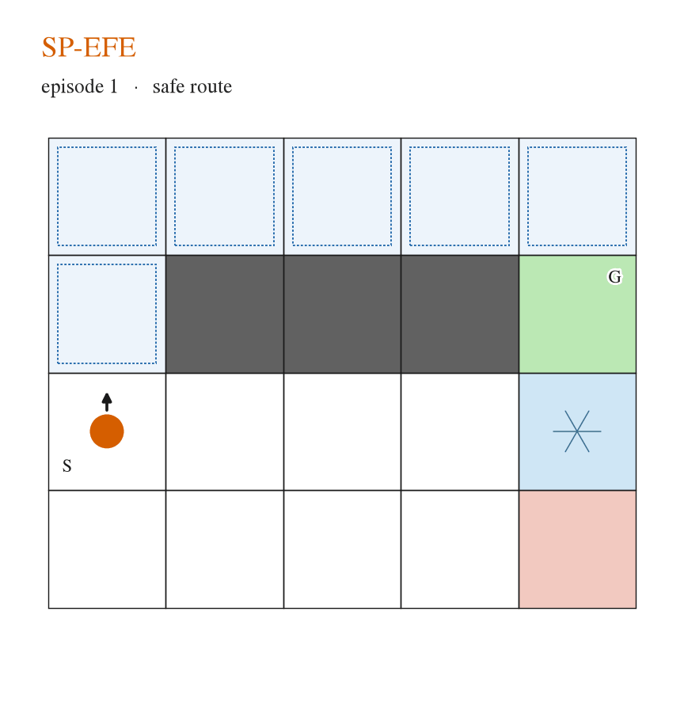
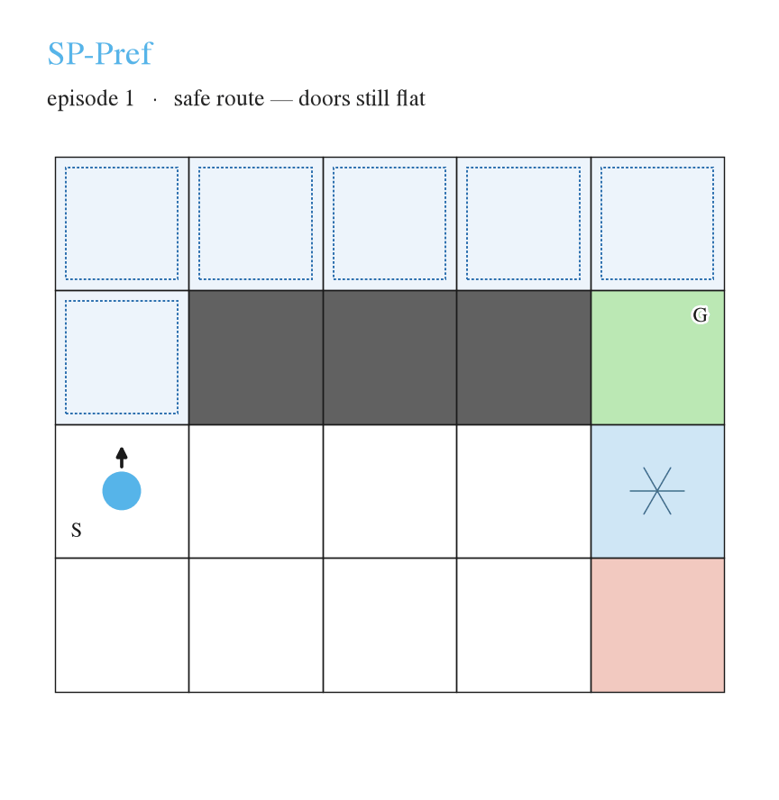

# Parameter Learning in Active Inference via Variational Message Passing

Experiment code for the IWAI 2026 paper *Parameter Learning in Active Inference via
Variational Message Passing* (B. Waldeck, University of Modena and Reggio Emilia).

The paper derives a single variational objective in which the entropy-correction
channels are substituted at their closed-form optima, so that conjugate Dirichlet
learning of the observation block $\theta_A$ and the transition block $\theta_B$
survives alongside the information-gain corrections. This repository contains the
message passing scheme and the two grid POMDPs used to validate it.




|  |  |
| -------------------------------------------------------------------------------------------------------------------------------- | ---------------------------------------------------------------------------------------------------------------------------------------------------------------- |
| SP-EFE stays on the safe route once the doors are learned.                                                                       | SP-Pref takes the safe route while the transitions are uniform (minor p of directly landing on G), then the ice.                                                 |


## Installation

```bash
uv sync                 # runtime only
uv sync --group dev     # + pytest
```

JAX on GPU: `uv sync --group cuda`. All scripts are run with `uv run python`.

## Start here

```bash
uv run python demo_sweep.py
```

A 5-cell corridor, printed end to end: the Dirichlet tables, the
information-gain weights $e^{\Delta_B}\ge1$, the channels converging to their
fixed point sweep by sweep, and the action posterior each ablation arrives at.
It takes a few seconds and needs no results files. Everything the scheme is made
of appears there at a size you can read off the terminal.

Then follow the code in this order:


| Read                                         | For                                                                                                              |
| -------------------------------------------- | ---------------------------------------------------------------------------------------------------------------- |
| `spmp/sweeps.py`                             | the factor graph, one sum-product sweep, channel damping                                                         |
| `spmp/tables.py`                             | how $\theta$ enters the graph: two expected-log tables                                                           |
| `spmp/info_gain.py`                          | $\Delta_A,\Delta_B$ — the per-entry $e^{\Delta}\ge1$ weights                                                     |
| `spmp/sp_efe.py`                             | **SP-EFE**: the two kernels, the fixed point, the entry point; SP-Pref / SP-Pref-Plan are its all-flags-off rows |
| `agent.py`                                   | the filter, count update and action rule every planner shares                                                    |
| `run_fog_walls.py`, `run_unmapped_detour.py` | the two experiments                                                                                              |


The whole scheme is two kernels:

$$
\log g_{\text{obs}}(y,x) = \log \tilde A + \log r(y\mid x) + c\Delta_A
$$

$$
\log g_{\text{dyn}}(x',x,u) = \log \tilde B + \Delta_B + \log r(u\mid x) - \log r(x'\mid x,u)
$$

Each channel $r$ is substituted at its closed-form optimum — the corresponding
conditional of $q$ — so a sweep is plain sum-product and the channels are
refreshed from the beliefs it produces. Uniform channels recover standard Bethe
BP. One planner is callable, `sp_efe_planning`; every row of the paper's
table is that function under a `Scheme` of kept corrections
(`paper_scheme(label)`, listed in `PAPER_ROWS`). The two kernels are
`observation_kernel` and `dynamics_kernel`, the refresh is `refresh_channels`,
and `objective_terms` is the objective written out term by term.

## Planner names

`--planner` / `--planners`, the saved `.npz` keys, and `figures/paper_figure.py` use the paper's labels. A superscript in the paper is a hyphenated suffix here: `SP-EFE-dyn` is SP-EFE with a −dyn superscript.


| Label                      | Terms kept                                                                               |
| -------------------------- | ---------------------------------------------------------------------------------------- |
| `SP-EFE`                   | full scheme: obs + dyn channels, $\Delta_A$, $\Delta_B$                                  |
| `SP-EFE-dyn`               | no dynamics channel                                                                      |
| `SP-EFE-DeltaB`            | dynamics channel on, $\Delta_B$ off                                                      |
| `SP-EFE-DeltaA-DeltaB`     | channels only (ambiguity, no novelty)                                                    |
| `SP-EFE-DeltaA-DeltaB-dyn` | as above, channel dropped too                                                            |
| `SP-Pref-Plan`             | planning correction $r_t(u_t\mid x_{t-1})$ only                                          |
| `SP-Pref`                  | no corrections                                                                           |
| `EFE`                      | enumerates all $4^H$ policies under the exact EFE                                        |
| `EFE-noamb-noig`           | enumerated EFE with ambiguity and both novelty terms zeroed                              |
| `SI-EFE`                   | sophisticated inference over the same one-step EFE terms, counts updated inside the tree |
| `SI-EFE-frozen`            | as `SI-EFE`, counts fixed inside the tree                                                |
| `Random`                   | uniform actions, learning still on                                                       |


## Reproducing the paper


### Figure 2 and Table 1, fog-walls (learning $\theta_A$)

```bash
uv run python run_fog_walls.py --compare --scenario learn-A \
    --maze fog-walls --horizon 8 --episodes 100 --n-seeds 5
```

Ablation rows (lower block of Table 1):

```bash
uv run python run_fog_walls.py --compare --scenario learn-A \
    --maze fog-walls --horizon 8 --episodes 100 --n-seeds 5 \
    --compare-planners SP-EFE-DeltaA-DeltaB SP-EFE-DeltaA-DeltaB-dyn
```

Known-$A$/$B$ control of Appendix C.2 (30 seeds, 30/30 vs 18/30):

```bash
uv run python run_fog_walls.py --compare --scenario known \
    --maze fog-walls --horizon 8 --n-seeds 30
```


### Figure 2 and Table 1, unmapped detour (learning $\theta_B$)

```bash
uv run python run_unmapped_detour.py --unmapped doors --compare \
    --episodes 300 --n-seeds 3
```

The `known` and `frozen` columns of Table 1, and the enumerated EFE:

```bash
uv run python run_unmapped_detour.py --unmapped doors --scenario known  --episodes 300
uv run python run_unmapped_detour.py --unmapped doors --scenario frozen --episodes 300
uv run python run_unmapped_detour.py --unmapped doors --scenario learn-B --episodes 100 \
    --planners EFE
```

Robustness checks of Appendix C.2 (permuted actions, mirrored layout, cells variant):

```bash
uv run python run_unmapped_detour.py --unmapped doors --action-order WSEN \
    --scenario learn-B --episodes 200
uv run python run_unmapped_detour.py --unmapped doors --layout mirror \
    --scenario learn-B --episodes 300 --n-seeds 3 --horizon 8
uv run python run_unmapped_detour.py --unmapped cells --compare \
    --episodes 200 --n-seeds 5
```

Each run prints a summary table and writes `figures/data/<tag>.npz` plus
`figures/figures/<tag>.{pdf,png}`. A `--out` or `--save` prefix inside
`figures/` is split the same way; any other prefix keeps the files together.
Use those flags to redirect so the committed arrays are not overwritten.

### The paper figure

`figures/data/` ships the `.npz` arrays behind Figure 2, so the figure can be
redrawn without re-running anything (about a second):

```bash
uv run python figures/paper_figure.py
```

Set `SP_EFE_FIG_OUT=/path/to/paper/figures` to write `exp_learning.pdf` straight
into a paper tree. Keep `WIDTH_FRAC` in the script equal to the `width=` option
of `\includegraphics` so the font sizes survive to the page.

## Layout

```
demo_sweep.py    the annotated walkthrough; read this first
spmp/            sum-product message passing (the paper's SP-MP)
  sweeps.py      safe_log, the forward/backward passes, channel damping
  tables.py      Dirichlet expected-log tables (geometric + arithmetic)
  info_gain.py   Δ contrasts: the per-entry e^Δ ≥ 1 information-gain weights
  sp_efe.py      kernels, channel fixed point, entry point, flags for every planner row
agent.py         the one shared protocol: filter, count update, action rule
dispatch.py      planner name -> planner, plus the enumerated EFE
sophisticated.py the enumerated EFE's terms recursed over outcomes (SI-EFE)
environments/
  stochastic_maze.py    fog-walls, the learn-θ_A maze
  unmapped_detour.py    unmapped detour, doors and cells variants
run_fog_walls.py        learn-θ_A experiment (learn-A / learn-B / known)
run_unmapped_detour.py  learn-θ_B experiment (learn-B / known / frozen)
viz.py                  single-episode belief overlays and GIFs (not used by the paper)
figures/
  paper_figure.py       redraws the paper figure from data/*.npz
  make_detour_gifs.py   conference GIFs of the doors detour
  paths.py              save prefix -> data/ and figures/
  data/                 .npz archives and run logs
  figures/              rendered png, pdf, gif
tests/           52 tests over tensors, planners, the demo and the episode loops
docs/            per-experiment result write-ups
```

## Tests

```bash
uv run python run_tests.py
```


## Provenance

This is a self-contained extension of the two paper experiments from the original research repository [UAI-MP-AIF-JAX](https://github.com/skoghoern/UAI-MP-AIF-JAX) from BIASLAB, which also hosts other environments and a full family of message passing variants.